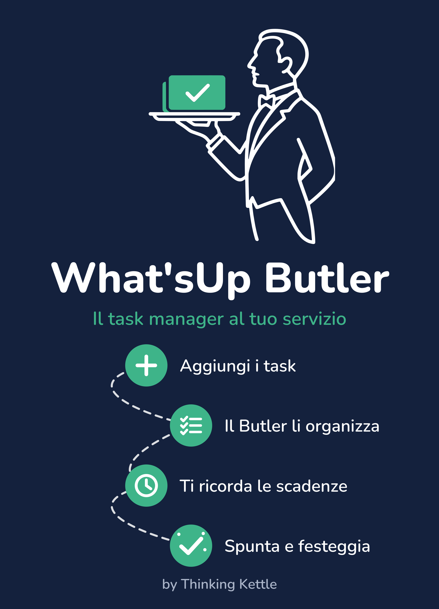

  <picture>
    <source media="(prefers-color-scheme: dark)" srcset="assets/wub-logo-horizontal-dark.png">
    
  </picture>

<h3 align="center">Il task manager al tuo servizio. 🎩</h3>

---

**What'sUp Butler** è il maggiordomo digitale che tiene in ordine le tue cose da fare. Tu gli passi i task, lui li sistema sul vassoio e te li porge al momento giusto.

## ✨ Come funziona

  

1. **Aggiungi i task.** Scrivi quello che devi fare, in un attimo.
2. **Il Butler li organizza.** Priorità e ordine ci pensa lui.
3. **Ti ricorda le scadenze.** Niente più "me n'ero dimenticato".
4. **Spunta e festeggia.** Ogni task completato è una piccola vittoria.

## 🛠️ Stato del progetto

🚧 In sviluppo. Le funzionalità qui sopra sono provvisorie e verranno aggiornate.

## 📦 Installazione

_Presto disponibile._

---

  Fatto con ☕ da <a href="https://thinkingkettle.it"><b>Thinking Kettle</b></a> · <i>Where ideas come to a boil.</i>

